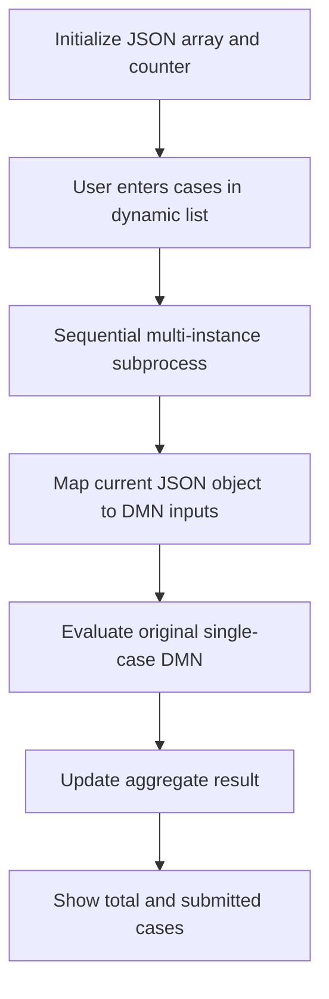

# Reusing a Single-Case DMN for an Arbitrary Number of Cases

## Purpose

This document describes a reusable Operaton pattern for applying an existing DMN decision to an arbitrary number of cases without duplicating the DMN logic or creating a separate BPMN branch for every case.

The central idea is:

1. Keep the original DMN focused on **one case**.
2. Store all submitted cases in one JSON array process variable.
3. Let the BPMN process iterate over that array.
4. Map the properties of the current JSON object to the inputs of the original DMN.
5. Aggregate the individual DMN outcomes, for example by counting the number of successful cases.

The number of cases is therefore runtime data. Two, twenty, or two hundred cases use the same DMN and BPMN definitions. The practical limit is determined by form usability, execution time, history volume, and platform configuration rather than by the model structure.

## Architecture



The implementation consists of five artifacts:

| Artifact | Responsibility |
| --- | --- |
| Single-case DMN | Evaluates one case and returns one result |
| Counter DMN | Initializes and updates the aggregate count using FEEL |
| BPMN process | Iterates over the JSON array and calls both DMNs |
| Input Form | Creates and edits the array of case objects |
| Result Form | Shows the aggregate count and the submitted cases |

## 1. Preserve the original single-case DMN

Do not copy the original decision table for every possible case. The original DMN must continue to accept the inputs for exactly one case.

For example, a single-case decision might expect:

| DMN input | Type |
| --- | --- |
| `criterionA` | boolean |
| `criterionB` | boolean |
| `category` | string |
| `amount` | number |
| `exclusionApplies` | boolean |

and return:

| DMN output | Type |
| --- | --- |
| `caseMeetsCriteria` | boolean |

The BPMN wrapper is responsible for repeatedly providing these inputs. The DMN itself does not need to know that other cases exist.

## 2. Define a JSON contract for the cases

Use one JSON array process variable. In this example its name is `cases`.

```json
{
  "cases": [
    {
      "reference": "Case 1",
      "criterionA": true,
      "criterionB": false,
      "category": "example",
      "amount": 125.50,
      "exclusionApplies": false
    },
    {
      "reference": "Case 2",
      "criterionA": false,
      "criterionB": true,
      "category": "example",
      "amount": 80,
      "exclusionApplies": true
    }
  ]
}
```

Every object in the array represents one call to the original DMN. Its property names should normally be identical to the DMN input names. This avoids unnecessary translation and makes the Form, JSON, BPMN mappings, and DMN easy to compare.

The `reference` property is metadata for users and reporting. It does not have to be passed to the decision unless the DMN needs it.

## 3. Initialize the variable as native JSON

The cases variable should exist as a native JSON variable before the Form opens. This is important because a dynamic list submits an array of objects rather than a primitive value.

With the Operaton Spin integration, an output parameter can initialize the variable:

```xml
<operaton:outputParameter name="cases">
  ${JSON('[{"reference":"Case 1","criterionA":false,"criterionB":false,"category":"","amount":0,"exclusionApplies":false}]')}
</operaton:outputParameter>
```

This produces a typed JSON variable instead of a plain string. It also gives the Form one initial row.

The Spin process-engine plugin must be available because the process later uses JSON functions such as `JSON(...)`, `.elements()`, and `.prop(...)`.

### Why initialization matters

If the dynamic list creates a previously unknown variable, Tasklist may be unable to infer that the value must be stored as JSON. Typical symptoms are:

- the Form renders and rows can be added;
- the user can enter data;
- Save works, but Complete remains unavailable or submission fails;
- the next BPMN step cannot call `.elements()` on the value.

Initializing the variable before the user task gives Tasklist an existing JSON type to update.

Depending on the Operaton Tasklist/Form integration version, users may still have to press **Save** once before **Complete** becomes active after changing a nested dynamic list. That is Tasklist synchronization behavior, not a requirement of the BPMN pattern itself.

## 4. Build the input Form as a dynamic list

The Form contains one dynamic-list component whose path is the JSON array variable:

```json
{
  "label": "Cases",
  "type": "dynamiclist",
  "path": "cases",
  "isRepeating": true,
  "allowAddRemove": true,
  "defaultRepetitions": 1,
  "components": [
    {
      "label": "Criterion A",
      "type": "checkbox",
      "key": "criterionA",
      "defaultValue": false,
      "id": "Field_criterionA"
    },
    {
      "label": "Criterion B",
      "type": "checkbox",
      "key": "criterionB",
      "defaultValue": false,
      "id": "Field_criterionB"
    },
    {
      "label": "Exclusion applies",
      "type": "checkbox",
      "key": "exclusionApplies",
      "defaultValue": false,
      "id": "Field_exclusionApplies"
    }
  ],
  "id": "Field_cases"
}
```

Inside a dynamic list, component keys are relative to the current list object. A checkbox with key `criterionA` therefore writes:

```text
cases[0].criterionA
cases[1].criterionA
cases[2].criterionA
...
```

### Automatically generated references

An expression component can generate a stable display reference from the one-based repetition index:

```json
{
  "type": "expression",
  "key": "reference",
  "expression": "=\"Case \" + string(i[1])",
  "computeOn": "change",
  "id": "Field_reference_generator"
}
```

The generated value can be shown read-only with a text component:

```json
{
  "text": "### {{ this.reference }}",
  "type": "text",
  "id": "Field_reference_readonly"
}
```

The expression field writes the value into the JSON object; the text component only presents it.

## 5. Iterate over the JSON array in BPMN

Use a multi-instance subprocess or activity. The collection is the list of elements in the Spin JSON array:

```xml
<bpmn:multiInstanceLoopCharacteristics
    isSequential="true"
    operaton:collection="${cases.elements()}"
    operaton:elementVariable="case" />
```

During every iteration:

- `cases` is the complete JSON array;
- `case` is the current JSON object;
- the subprocess calls the same single-case DMN;
- the process updates the shared aggregate.

### Sequential versus parallel

Use `isSequential="true"` when every iteration updates one shared counter. Parallel instances could read and write the same count simultaneously and lose updates.

Parallel execution is possible when each iteration writes an independent result and aggregation happens afterwards, but that is a different and more elaborate pattern.

## 6. Add one BPMN input mapping per DMN input

The Business Rule Task still references the original decision key:

```xml
<bpmn:businessRuleTask
    id="BusinessRuleTask_EvaluateCase"
    name="Evaluate case"
    operaton:decisionRef="OriginalDecision"
    operaton:decisionRefBinding="latest"
    operaton:mapDecisionResult="singleEntry"
    operaton:resultVariable="caseMeetsCriteria">
```

Its input mappings read the properties of the current JSON object:

```xml
<bpmn:extensionElements>
  <operaton:inputOutput>
    <operaton:inputParameter name="criterionA">
      ${case.prop("criterionA").boolValue()}
    </operaton:inputParameter>
    <operaton:inputParameter name="criterionB">
      ${case.prop("criterionB").boolValue()}
    </operaton:inputParameter>
    <operaton:inputParameter name="category">
      ${case.prop("category").stringValue()}
    </operaton:inputParameter>
    <operaton:inputParameter name="amount">
      ${case.prop("amount").numberValue()}
    </operaton:inputParameter>
    <operaton:inputParameter name="exclusionApplies">
      ${case.prop("exclusionApplies").boolValue()}
    </operaton:inputParameter>
  </operaton:inputOutput>
</bpmn:extensionElements>
```

The mapping name must equal the variable name used by the DMN input expression.

Common JSON conversions are:

| JSON value | Spin access |
| --- | --- |
| boolean | `.boolValue()` |
| string | `.stringValue()` |
| number | `.numberValue()` |
| nested property | `.prop("child")` followed by the appropriate accessor |
| array | `.elements()` |

Dates are normally transported as ISO-formatted strings and converted in FEEL or before the decision call, depending on the contract used by the original DMN.

## 7. Map the DMN result predictably

If the original DMN returns exactly one named output, use:

```xml
operaton:mapDecisionResult="singleEntry"
operaton:resultVariable="caseMeetsCriteria"
```

This makes the process variable a boolean instead of a result map.

If the original decision has multiple outputs, `singleEntry` is not appropriate. In that situation, either:

- use a result-map mapping and extract the required output; or
- add a small wrapper decision that returns the one value required by the loop.

## 8. Aggregate results with FEEL

A small counter DMN keeps the BPMN free of counting logic.

Initialize the count with a literal expression:

```feel
0
```

Update it after every single-case evaluation:

```feel
if caseMeetsCriteria = true
then matchingCaseCount + 1
else matchingCaseCount
```

The update decision accepts:

| Input | Type |
| --- | --- |
| `matchingCaseCount` | integer |
| `caseMeetsCriteria` | boolean |

and returns the new `matchingCaseCount` as a single integer entry.

Because the multi-instance subprocess is sequential, every iteration sees the count written by the previous iteration.

## 9. Show the result

The result Form can bind a disabled number field to the aggregate:

```json
{
  "label": "Number of cases that meet the criteria",
  "type": "number",
  "key": "matchingCaseCount",
  "disabled": true,
  "id": "Field_matchingCaseCount"
}
```

It can also display the submitted array using a dynamic list with:

- the same path as the input Form;
- `allowAddRemove: false`;
- read-only child fields.

This provides an audit-friendly summary of the values that were assessed.

# Worked example: Ingezetene

## Original single-case contract

The reusable `Ingezetene` decision has the stable decision key:

```text
Ingezetene
```

It accepts six boolean inputs:

| Input | Meaning |
| --- | --- |
| `persoonWoontInBES` | Person lives in the BES |
| `hoofdverblijfInBES` | Main residence is in the BES |
| `ingeschrevenInPIVA` | Person is registered in PIVA |
| `rechtmatigVerblijf` | Residence is lawful |
| `duurzameBandMetBES` | Person has a durable connection with the BES |
| `uitsluitingVanToepassing` | An exclusion applies |

It returns:

```text
persoonIngezetene : boolean
```

The example decision implements:

```feel
(persoonWoontInBES
 or hoofdverblijfInBES
 or ingeschrevenInPIVA
 or rechtmatigVerblijf
 or duurzameBandMetBES)
and not(uitsluitingVanToepassing)
```

In the supplied DMN this is represented by a `FIRST` decision table:

1. If `uitsluitingVanToepassing = true`, return `false`.
2. One rule for each positive boolean returns `true` when that value is true and the exclusion is false.
3. A final fallback returns `false`.

The explicit rules make the OR behavior unambiguous in Operaton and give the exclusion priority.

## JSON process variable

The BPMN stores the cases in the variable `gevallen`:

```json
{
  "gevallen": [
    {
      "kenmerk": "Geval 1",
      "persoonWoontInBES": false,
      "hoofdverblijfInBES": false,
      "ingeschrevenInPIVA": false,
      "rechtmatigVerblijf": false,
      "duurzameBandMetBES": true,
      "uitsluitingVanToepassing": false
    },
    {
      "kenmerk": "Geval 2",
      "persoonWoontInBES": false,
      "hoofdverblijfInBES": false,
      "ingeschrevenInPIVA": false,
      "rechtmatigVerblijf": false,
      "duurzameBandMetBES": false,
      "uitsluitingVanToepassing": true
    }
  ]
}
```

For this example:

- `Geval 1` evaluates to `true` because one positive indicator is true and no exclusion applies;
- `Geval 2` evaluates to `false` because the exclusion has priority;
- `aantalIngezetenen` becomes `1`.

## Input Form

The input Form uses:

```json
{
  "type": "dynamiclist",
  "path": "gevallen",
  "isRepeating": true,
  "allowAddRemove": true
}
```

Each row contains components with these keys:

```text
kenmerk
persoonWoontInBES
hoofdverblijfInBES
ingeschrevenInPIVA
rechtmatigVerblijf
duurzameBandMetBES
uitsluitingVanToepassing
```

The `kenmerk` is generated with:

```feel
="Geval " + string(i[1])
```

The remaining values are checkboxes with `defaultValue: false`.

## JSON initialization in BPMN

Before the input user task, the process creates `gevallen` as a native JSON array:

```xml
<operaton:outputParameter name="gevallen">
  ${JSON('[{"kenmerk":"Geval 1","persoonWoontInBES":false,"hoofdverblijfInBES":false,"ingeschrevenInPIVA":false,"rechtmatigVerblijf":false,"duurzameBandMetBES":false,"uitsluitingVanToepassing":false}]')}
</operaton:outputParameter>
```

## Multi-instance configuration

The subprocess iterates over every JSON object:

```xml
<bpmn:multiInstanceLoopCharacteristics
    isSequential="true"
    operaton:collection="${gevallen.elements()}"
    operaton:elementVariable="geval" />
```

This XML is independent of the number of cases.

## Ingezetene input mappings

The single Business Rule Task contains one mapping for every original DMN input:

```xml
<operaton:inputOutput>
  <operaton:inputParameter name="persoonWoontInBES">
    ${geval.prop("persoonWoontInBES").boolValue()}
  </operaton:inputParameter>
  <operaton:inputParameter name="hoofdverblijfInBES">
    ${geval.prop("hoofdverblijfInBES").boolValue()}
  </operaton:inputParameter>
  <operaton:inputParameter name="ingeschrevenInPIVA">
    ${geval.prop("ingeschrevenInPIVA").boolValue()}
  </operaton:inputParameter>
  <operaton:inputParameter name="rechtmatigVerblijf">
    ${geval.prop("rechtmatigVerblijf").boolValue()}
  </operaton:inputParameter>
  <operaton:inputParameter name="duurzameBandMetBES">
    ${geval.prop("duurzameBandMetBES").boolValue()}
  </operaton:inputParameter>
  <operaton:inputParameter name="uitsluitingVanToepassing">
    ${geval.prop("uitsluitingVanToepassing").boolValue()}
  </operaton:inputParameter>
</operaton:inputOutput>
```

The task configuration is:

```xml
operaton:decisionRef="Ingezetene"
operaton:decisionRefBinding="latest"
operaton:mapDecisionResult="singleEntry"
operaton:resultVariable="persoonIngezetene"
```

## Counter decisions

The process initializes:

```feel
aantalIngezetenen = 0
```

After each evaluation it applies:

```feel
if persoonIngezetene = true
then aantalIngezetenen + 1
else aantalIngezetenen
```

After the final iteration, `aantalIngezetenen` is shown in the result Form.

# Manual conversion checklist for another DMN

Use the following procedure when adapting this pattern manually.

## A. Inspect the original DMN

- Record its decision key.
- Record every input-expression variable name.
- Record the FEEL type of every input.
- Record the output name and type.
- Confirm whether the decision has one output or several outputs.
- Do not duplicate or rewrite the business rules merely to support more cases.

## B. Define the JSON object

- Add one property for every DMN input.
- Use the same property names where possible.
- Choose JSON values compatible with the DMN input types.
- Add metadata such as a case reference only when useful.
- Create an example object containing every property and a safe default.

## C. Update the input Form

- Create one dynamic list bound to the array variable.
- Add one child component per JSON property that the user must enter.
- Make every child key match the JSON property name.
- Supply explicit defaults, especially `false` for checkboxes.
- Generate or validate any case reference.

## D. Initialize the process variable

- Create the array as native JSON before the input Form opens.
- Seed at least one complete object if the Form should initially show one row.
- Do not initialize the array as a quoted JSON string.

## E. Configure the loop

- Use `${arrayVariable.elements()}` as the collection.
- Give the current object a clear singular element-variable name.
- Use sequential execution when iterations update shared state.

## F. Map the current object to the DMN

- Add exactly one input parameter for every original DMN input.
- Match parameter names exactly.
- Use the correct Spin value accessor.
- Decide how missing or optional properties should be handled.
- Keep the Business Rule Task pointed at the stable decision key.

## G. Map and aggregate the result

- Use `singleEntry` only for a single-output decision.
- Store the current result in a clearly named variable.
- Initialize aggregates before the loop.
- Update aggregates after every decision call.
- Avoid parallel updates to one shared variable.

## H. Build the result Form

- Show the aggregate as read-only or disabled.
- Optionally show the submitted cases read-only.
- Use the same dynamic-list path so the JSON structure remains visible.

## I. Test before deployment

At minimum, test:

- no positive criteria;
- each positive criterion individually;
- multiple positive criteria;
- an exclusion by itself;
- positive criteria combined with an exclusion;
- one case;
- multiple cases;
- adding and removing rows;
- Save followed by Complete in Tasklist;
- an empty or missing optional value, when allowed.

# Deployment and versioning

Deploy the BPMN, Forms, original DMN, and aggregation DMN together when installing the example in a clean environment.

Keep referenced IDs stable:

```text
Decision key: Ingezetene
Process ID: IngezeteneBulkProcess
Input Form ID: ingezetene-bulk-input
Result Form ID: ingezetene-bulk-result
```

Use versioned filenames for downloads and deployment packages, for example:

```text
ingezetene-single-case-v5.dmn
ingezetene-bulk-process-v3.bpmn
ingezetene-bulk-input-v3.form
ingezetene-bulk-result-v2.form
```

The version suffix belongs to the resource filename, not to the decision key, process ID, or Form ID. The BPMN can therefore continue to use `latest` bindings without changing references for every revision.

# Common mistakes

| Mistake | Consequence | Correction |
| --- | --- | --- |
| Copying the DMN once per possible case | Model size grows with the maximum case count | Keep one single-case DMN and iterate in BPMN |
| Creating separate BPMN branches for Case 1, Case 2, etc. | BPMN must change whenever the maximum changes | Use a multi-instance subprocess |
| Submitting an untyped array from the Form | Save/Complete or `.elements()` may fail | Initialize the variable as native JSON |
| Form key differs from JSON property | The mapping reads a missing property | Use one shared naming contract |
| Mapping omitted for a DMN input | Evaluation fails or uses an unintended value | Add one mapping per original input |
| Wrong Spin accessor | Type mismatch during DMN evaluation | Match accessor to JSON/DMN type |
| Using `singleEntry` for multiple outputs | Result mapping fails | Use a result map or a wrapper decision |
| Parallel loop updates one counter | Lost increments are possible | Use sequential execution or aggregate afterwards |
| Checkbox has no explicit default | Missing/null values can reach the DMN | Set `defaultValue` to `false` |
| Version suffix added to internal IDs | References break on every deployment | Version filenames only; keep IDs stable |

# Summary

The scalable pattern is not to make the original DMN understand lists. Instead, preserve the DMN as a deterministic single-case function and let BPMN provide orchestration:

```text
JSON array → current JSON object → input mappings → original DMN → aggregate
```

Only the Form row definition and the BPMN input mappings depend on the number of fields in the original DMN. Neither the DMN nor BPMN structure depends on the number of cases supplied at runtime.
